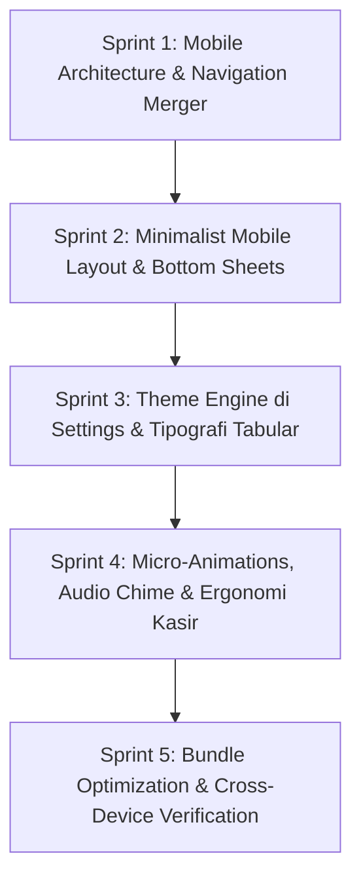

# Unified Implementation & Polish Plan: Human-Grade POS & Mobile Architecture (ClearTask v3.7.0)

Dokumen ini adalah rencana implementasi terpadu (_Unified Master Plan_) yang menggabungkan perombakan arsitektur navigasi mobile, penyempurnaan ergonomi kasir, eliminasi gaya _AI-slop_, penyediaan palet tema fleksibel di Pengaturan, arsitektur layout desktop vs mobile, serta micro-animations dan audio-haptic feedback.

---

## 1. Filosofi Desain: Eliminasi "AI-Slop" Menuju "Human-Grade POS"

Kita membuang seluruh arketipe _Cyber-Neumorphism_ lama (shadow ganda tebal, neon glow berlebihan, background blur yang memberatkan GPU) dan beralih ke standar **Human-Grade High-Performance POS** (standar kelas dunia seperti Linear, Stripe, Square POS, dan GitHub):

```
┌────────────────────────────────────────────────────────────────────────┐
│ 🖥️ DESKTOP: "Command Center & Clean Enterprise POS"                   │
│ • Surface: Solid Deep Slate (#0c0e12 base, #161920 card).              │
│ • Borders: Hairline 1px presisi (rgba(255,255,255,0.08)), zero blur.   │
│ • Layout: Split-Panel (65% Katalog Kiri ↔ 35% Sticky Checkout Kanan). │
│ • Interaksi: Keyboard-first (Numpad input, shortcut pencarian cepat).  │
│ • Theme: Pilihan tema warna fleksibel di Pengaturan (Cobalt/Emerald).  │
└────────────────────────────────────────────────────────────────────────┘
                                   ▲
                                   │ Sinergi Data (Dexie IndexedDB)
                                   ▼
┌────────────────────────────────────────────────────────────────────────┐
│ 📱 MOBILE: "Minimalist & User-Friendly Handheld POS"                   │
│ • Surface: Ultra-Minimalist Solid Dark/Light, 100% bebas lag blur.     │
│ • Ergonomi: Thumb-Zone Focus (semua tombol aksi di jangkauan jempol).  │
│ • Navigasi: BottomNav 5 Tab Presisi (Database selalu terlihat).        │
│ • Modals: Bottom-Sheet Drawer (laci naik dari bawah, anti-tutup keyboard)│
│ • Tombol: Tactile response mantap, touch target min 36px–44px.         │
│ • Audio/Micro: Beep renyah Web Audio API + spring scale saat ditekan. │
└────────────────────────────────────────────────────────────────────────┘
```

---

## 2. Pilihan Tema Fleksibel di Menu Pengaturan (Expanded Theme Engine)

Pengguna kasir dan pemilik toko dapat bebas memilih preferensi warna tema sesuai jenis bisnis di menu _Pengaturan_:

1. 🔵 **Cobalt Pro (Default)**: `#2563eb` — Standar software enterprise & SaaS modern (bersih, tajam, profesional).
2. 🟢 **Emerald Merchant**: `#10b981` — Segar, ramah, melambangkan transaksi cuan (sangat cocok untuk toko ritel, kelontong, dan kafe).
3. 🟠 **Amber Warm**: `#f59e0b` — Hangat, tingkat _eye fatigue_ paling rendah saat menatap layar berjam-jam.
4. 🟣 **Iris Modern**: `#8b5cf6` — Vibe fintech kontemporer.
5. ⚪ **Monochrome Minimalist**: `#f4f4f5` / `#18181b` — Gaya hitam-putih murni tanpa aksen mencolok.

Setiap warna tema yang dipilih otomatis menyinkronkan seluruh stroke SVG, active tab indicator, button background, dan focus ring di seluruh aplikasi.

---

## 3. Tipografi Hybrid (Option 4): Brand Distinction + Data Stability

1. **Brand & Main Hero Titles**: Menggunakan **Outfit**
   - Dipertahankan untuk logo, nama brand ClearTask, dan header modal utama agar identitas unik brand tetap kuat.
2. **Core Data POS, Angka Finansial, & Input**: Menggunakan **Inter / System Font**
   - Diaktifkan fitur OpenType: `tabular-nums` dan `zero` (slashed zero).
   - Menghilangkan _layout jitter_ (angka bergetar saat bertambah/berkurang).
   - Memastikan pembedaan jelas antara angka `0` vs huruf `O`, dan angka `1` vs huruf `I` / `l` pada barcode dan kode SKU barang.
3. **Fluid Typography Scale**:
   - Di desktop: Heading `22px–26px` proporsional.
   - Di mobile: Heading dibatasi maksimal `18px–20px` agar tidak memakan ruang vertikal layar kasir.

---

## 4. Micro-Animations & Audio-Haptic Feedback (Emil Kowalski Style)

1. **Audio Feedback Empuk (Web Audio API)**:
   - Ubah nada beep kasir dari gelombang `square` tajam menjadi **dual-harmonic sine chime (1200Hz + 1600Hz)** selama 60ms yang empuk dan renyah.
   - Ascending chime yang memuaskan saat transaksi pembayaran tuntas.
   - Haptic vibration 20ms di Android saat kuantitas ditekan, dan 3-pulse saat checkout selesai.
2. **Micro-Animations Fisik (Spring)**:
   - **Button Spring**: `active:scale-[0.96]` dengan transisi `duration-100 ease-out` pada semua tombol aksi kasir.
   - **Badge Counter Pop**: Counter kuantitas keranjang pop-out sekejap (`scale-125`) lalu kembali saat item bertambah.
   - **Slide-out Cart Item**: Saat item dihapus dari keranjang, item meluncur ke kiri dengan transisi `opacity: 0; max-height: 0; margin-bottom: 0` (180ms) agar daftar di bawahnya bergeser naik mulus tanpa kedipan kasar.
   - **Drawer Slide-up**: Animasi laci bawah mobile menggunakan kurva Apple Spring `cubic-bezier(0.16, 1, 0.3, 1)`.

---

## 5. Rencana Eksekusi Bertahap (5 Phased Sprints)



---

### Sprint 1: Mobile Architecture & Navigation Merger

**Target**: Merampingkan navigasi mobile agar tab Database tidak lagi tersembunyi, dan membersihkan TopBar pada layar sempit.

- [x] **1.1 Integrasi Sub-tab di [LaporanExport.tsx](file:///c:/Users/fikza/OneDrive/Documents/bebas_kelas/ClearTask/src/components/LaporanExport.tsx)**:
  - Satukan `RiwayatSesi` ke dalam halaman Laporan menggunakan Segmented Control / Pills: **"Penjualan & Analitik"** ↔ **"Riwayat Sesi Kerja"**.
  - Sub-tab `'penjualan'`: Menampilkan grafik `ReportingChart`, metric cards, filter tanggal, dan tabel transaksi.
  - Sub-tab `'sesi'`: Merender `<RiwayatSesi />` secara langsung di dalam kontainer laporan.
- [x] **1.2 Perampingan [BottomNav.tsx](file:///c:/Users/fikza/OneDrive/Documents/bebas_kelas/ClearTask/src/components/layout/BottomNav.tsx) ke 5 Tab Presisi**:
  - Hapus tab mandiri `riwayat-sesi` dari BottomNav.
  - Urutan tab final:
    1. `input` (Input Penjualan / POS)
    2. `keluaran` (Keluaran / Biaya)
    3. `hutang-piutang` (Hutang Piutang)
    4. `laporan` (Laporan & Sesi)
    5. `database` (Database, Master Barang & Trash)
  - Atur layout menjadi `grid grid-cols-5` (masing-masing 20% width / `flex-1`), 100% pas di layar HP mana pun tanpa scrollbar horizontal.
- [x] **1.3 Optimasi [TopBar.tsx](file:///c:/Users/fikza/OneDrive/Documents/bebas_kelas/ClearTask/src/components/layout/TopBar.tsx) untuk Layar Sempit (320px–360px)**:
  - Sembunyikan shortcut keyboard desktop Ctrl+K pada mobile (`hidden sm:flex`).
  - Atur judul aplikasi dengan `truncate min-w-0 max-w-[140px] sm:max-w-none` agar tidak mendesak tombol aksi.
  - Rampingkan padding dan gap tombol aksi mobile (`gap-1.5`, `w-8 h-8 sm:w-10 sm:h-10`).
  - Kurangi margin bawah header di mobile (`mb-3 sm:mb-6`) untuk menghemat area vertikal kasir.

---

### Sprint 2: Minimalist Mobile Layout & Bottom Sheets

**Target**: Menerapkan tampilan mobile yang ultra-clean, user-friendly, dan mengganti popup tengah menjadi bottom sheet.

- [x] **2.1 Mobile Bottom Sheet Drawer untuk Keranjang & Form**:
  - Ubah tampilan keranjang mobile (`showMobileCart`) menjadi Bottom Sheet Drawer dengan animasi slide-up halus dari tepi bawah layar.
  - Sediakan handle swipe-down dan tombol aksi checkout di bagian bawah laci.
  - Form dialog di mobile (Catat Pengeluaran, Form Pelanggan Hutang) mengadopsi format Bottom Sheet agar tidak tertutup keyboard virtual.
- [x] **2.2 Eliminasi Neumorphic Slop & Penyelarasan Hairline 1px**:
  - Bersihkan class `.neo-flat` dan `.neo-pressed` dari [index.css](file:///c:/Users/fikza/OneDrive/Documents/bebas_kelas/ClearTask/src/index.css).
  - Terapkan background solid bersih (`#161920` di dark, `#ffffff` di light) dengan hairline border 1px (`rgba(255,255,255,0.08)` / `rgba(0,0,0,0.08)`).
- [x] **2.3 Desktop Split-Panel Polishing**:
  - Optimalkan layout katalog kiri (65%) dan sticky cart kanan (35%) pada layar desktop agar kasir meja dapat bekerja tanpa navigasi bolak-balik.

---

### Sprint 3: Expanded Theme Engine di Settings & Tipografi Tabular

**Target**: Menambahkan pilihan warna tema baru di Pengaturan dan mengaktifkan angka tabular stabil.

- [x] **3.1 Penambahan Palet Warna di [SettingsModal.tsx](file:///c:/Users/fikza/OneDrive/Documents/bebas_kelas/ClearTask/src/components/SettingsModal.tsx)**:
  - Tambahkan pilihan tema warna: Cobalt Pro (`#2563eb`), Emerald Merchant (`#10b981`), Amber Warm (`#f59e0b`), Iris Modern (`#8b5cf6`), dan Monochrome.
  - Pastikan penggantian warna tema otomatis mengupdate CSS variable `--color-primary` dan seluruh stroke icon SVG secara dinamis.
- [x] **3.2 Setup Tipografi Hybrid (Outfit + Inter/System)**:
  - Konfigurasi `index.css`:
    ```css
    --font-sans: 'Inter', ui-sans-serif, system-ui, -apple-system, sans-serif;
    --font-brand: 'Outfit', var(--font-sans);
    ```
  - Tambahkan utility tabular figures:
    ```css
    .tabular-nums {
      font-variant-numeric: tabular-nums;
      font-feature-settings:
        'tnum' 1,
        'zero' 1;
    }
    ```
  - Terapkan `.tabular-nums` pada seluruh harga Rupiah, jam sesi, kuantitas kasir, dan persentase profit.
- [x] **3.3 Perbaikan Outdoor High Contrast & FOUC Loader**:
  - Di `index.css`, perbaiki Outdoor Mode agar border tidak hilang pada Light Mode:
    ```css
    html:not(.light).outdoor-high-contrast * {
      border-color: rgba(255, 255, 255, 0.3) !important;
    }
    html.light.outdoor-high-contrast * {
      border-color: rgba(0, 0, 0, 0.45) !important;
    }
    ```
  - Samakan background `#app-loader` di `index.html` menjadi `#0c0e12`.

---

### Sprint 4: Micro-Animations, Audio Chime & Ergonomi Kasir

**Target**: Menerapkan feedback sentuhan & suara kasir profesional, reposisi floating cart, dan touch target 44px.

- [x] **4.1 Polish Audio & Haptic Feedback di [audioFeedback.ts](file:///c:/Users/fikza/OneDrive/Documents/bebas_kelas/ClearTask/src/utils/audioFeedback.ts)**:
  - Ganti gelombang square dengan dual-sine chime (1200Hz + 1600Hz) empuk & renyah saat scan/tambah item.
  - Perhalus nada ascending chord saat checkout dan feedback getar haptic.
- [x] **4.2 Micro-Animations Spring & Physics**:
  - Tambahkan spring bounce `active:scale-[0.96]` pada tombol kasir dan pop-up scale badge kuantitas.
  - Terapkan animasi slide-out halus saat menghapus barang dari keranjang kasir di [CartItemList.tsx](file:///c:/Users/fikza/OneDrive/Documents/bebas_kelas/ClearTask/src/components/pos/CartItemList.tsx).
- [x] **4.3 Koreksi Posisi Floating Mobile Cart di [InputPenjualan.tsx](file:///c:/Users/fikza/OneDrive/Documents/bebas_kelas/ClearTask/src/components/InputPenjualan.tsx)**:
  - Geser tombol keranjang mengambang dari `bottom-6` (24px) ke `bottom-20` (80px / `calc(4.5rem + env(safe-area-inset-bottom, 0px))`).
- [x] **4.4 Peningkatan Touch Target Tombol Kuantitas di [CartItemList.tsx](file:///c:/Users/fikza/OneDrive/Documents/bebas_kelas/ClearTask/src/components/pos/CartItemList.tsx)**:
  - Perbesar tombol `-1`, `+1`, dan `+5` dari `w-7 h-7` (28px) menjadi minimal `w-8 h-8` (32px) dengan touch padding transparan (envelope sentuh ≥ 36px–40px).
  - Hapus emoji mentah `🏷️` dan ganti dengan ikon tag SVG monoline rapi.
- [x] **4.5 Anti-Delay Sentuhan & Android Highlight Elimination**:
  - Pasang `touch-action: manipulation` dan `-webkit-tap-highlight-color: transparent` pada root stylesheet.

---

### Sprint 5: Bundle Optimization, PWA & Cross-Device Verification

**Target**: Memangkas bundle size, menuntaskan PWA branding, dan validasi fungsional menyeluruh.

- [x] **5.1 Pemisahan Chunk Scanner di [vite.config.js](file:///c:/Users/fikza/OneDrive/Documents/bebas_kelas/ClearTask/vite.config.js)**:
  - Tambahkan manual chunk untuk `@zxing/library` ke chunk mandiri `vendor-scanner` (memangkas initial load > 400 kB).
- [x] **5.2 Optimasi Query Memori di [useTransactionMetrics.ts](file:///c:/Users/fikza/OneDrive/Documents/bebas_kelas/ClearTask/src/hooks/useTransactionMetrics.ts)**:
  - Ganti `.toArray()` historis dengan query first/count ringan.
- [x] **5.3 Penyelarasan PWA Manifest & Offline Fallback**:
  - Di `public/manifest.json`: selaraskan `theme_color` dan `background_color` ke tema solid baru.
  - Di `public/offline.html`: selaraskan tema inline CSS ke styling solid profesional tanpa ketergantungan CDN luar.
- [x] **5.4 Typecheck, Tests & Simulasi Viewport**:
  - `npm run build` dan `npx tsc --noEmit` lolos 100%.
  - Unit & integration tests lolos tanpa kegagalan.
  - Layout responsive desktop split-panel & mobile bottom sheet tuntas.

---

## 6. Matriks Perubahan & File yang Terlibat

| File                                                                                                                           | Komponen | Perubahan Kunci                                                             |
| ------------------------------------------------------------------------------------------------------------------------------ | -------- | --------------------------------------------------------------------------- |
| [LaporanExport.tsx](file:///c:/Users/fikza/OneDrive/Documents/bebas_kelas/ClearTask/src/components/LaporanExport.tsx)          | Page     | Integrasi Segmented Control untuk menampilkan sub-tab Riwayat Sesi          |
| [BottomNav.tsx](file:///c:/Users/fikza/OneDrive/Documents/bebas_kelas/ClearTask/src/components/layout/BottomNav.tsx)           | Nav      | Pemangkasan ke 5 tab tetap, tab Database langsung muncul                    |
| [TopBar.tsx](file:///c:/Users/fikza/OneDrive/Documents/bebas_kelas/ClearTask/src/components/layout/TopBar.tsx)                 | Header   | Sembunyikan Ctrl+K di mobile, compact padding, judul anti-truncate clash    |
| [InputPenjualan.tsx](file:///c:/Users/fikza/OneDrive/Documents/bebas_kelas/ClearTask/src/components/InputPenjualan.tsx)        | POS      | Floating cart naik ke `bottom-20`, layout mobile bottom-sheet drawer        |
| [SettingsModal.tsx](file:///c:/Users/fikza/OneDrive/Documents/bebas_kelas/ClearTask/src/components/SettingsModal.tsx)          | Modal    | Penambahan palet warna modern (Cobalt, Emerald, Amber, Iris, Monochrome)    |
| [audioFeedback.ts](file:///c:/Users/fikza/OneDrive/Documents/bebas_kelas/ClearTask/src/utils/audioFeedback.ts)                 | Audio    | Dual-sine chime empuk, haptic feedback, switch suara kasir                  |
| [CartItemList.tsx](file:///c:/Users/fikza/OneDrive/Documents/bebas_kelas/ClearTask/src/components/pos/CartItemList.tsx)        | Cart     | Perbesar tombol kuantitas ke 36px+, hapus raw emoji, animasi slide-out      |
| [index.css](file:///c:/Users/fikza/OneDrive/Documents/bebas_kelas/ClearTask/src/index.css)                                     | Styles   | Hapus neumorphism slop, pasang hairline borders, touch-action, hybrid fonts |
| [vite.config.js](file:///c:/Users/fikza/OneDrive/Documents/bebas_kelas/ClearTask/vite.config.js)                               | Build    | Chunking terpisah untuk `@zxing/library` (`vendor-scanner`)                 |
| [useTransactionMetrics.ts](file:///c:/Users/fikza/OneDrive/Documents/bebas_kelas/ClearTask/src/hooks/useTransactionMetrics.ts) | Hook     | Eliminasi `.toArray()` berat di IndexedDB LiveQuery                         |
