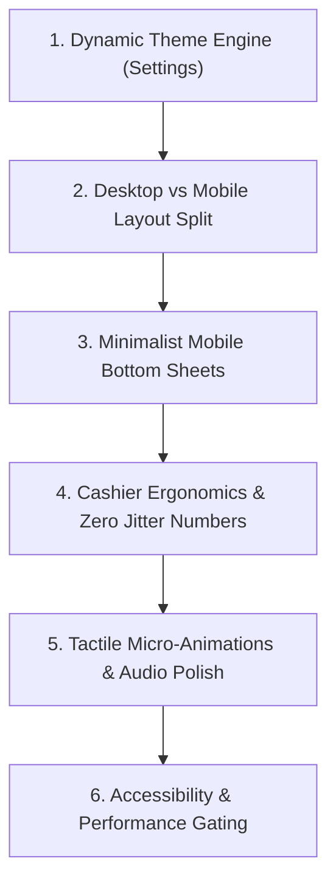

# UI/UX Polish Plan: Minimalist, Tactile & Audio-Visual Polish (ClearTask v3.7.0)

Dokumen ini adalah panduan detail pemolesan antarmuka (_Polish Plan_) untuk ClearTask, berfokus pada **tampilan minimalis, user-friendly di mobile, palet warna fleksibel di Pengaturan, arsitektur layout desktop vs mobile, serta micro-animations & audio-haptic feedback**.

---

## 1. Pemetaan Filosofi & Respons Masukan Pengguna

Berdasarkan tinjauan mendalam dan masukan:

1. **Pilihan Warna di Pengaturan (Expanded Theme Engine)**:
   - Pengguna disediakan palet warna profesional yang ramah mata di menu _Pengaturan_:
     - 🔵 **Cobalt Pro (Default)**: `#2563eb` — Bersih, standar software enterprise & SaaS modern.
     - 🟢 **Emerald Merchant**: `#10b981` — Segar, ramah, melambangkan transaksi cuan (retail & kafe).
     - 🟠 **Amber Warm**: `#f59e0b` — Hangat, eye-strain paling rendah untuk shift kasir panjang.
     - 🟣 **Iris Modern**: `#8b5cf6` — Vibe fintech kontemporer.
     - ⚪ **Monochrome Minimalist**: `#f4f4f5` / `#18181b` — Hitam-putih murni tanpa warna mencolok.
   - Setiap warna tema otomatis menyinkronkan seluruh stroke SVG, active tab indicator, button background, dan focus ring secara menyeluruh.
2. **Arsitektur Layout: Desktop vs Mobile**:
   - **Desktop (Split-Panel Command Center)**:
     - Kiri: Katalog barang & pencarian cepat (65% lebar).
     - Kanan: Sticky Cart & Panel Pembayaran (35% lebar) selalu berdampingan permanen tanpa perlu toggle.
   - **Mobile (Minimalist Single-Column & Bottom Sheet)**:
     - Layar dibuat ultra-clean: daftar barang sederhana, stok & harga jelas.
     - Mengubah popup modal tengah menjadi **Bottom Sheet Drawer** (laci naik dari bawah), sangat ramah jempol dan tidak tertutup keyboard HP.
3. **Tipografi Hybrid**:
   - **Outfit** untuk Display/Brand ClearTask.
   - **Inter / System Font** dengan `tabular-nums` & slashed zero untuk data nominal Rupiah dan tabel transaksi kasir.
4. **Micro-Animations & Audio Feedback Berkelas**:
   - Sentuhan animasi fisik (_physics-based spring_) dan feedback suara kasir sintetis yang empuk (menggunakan Web Audio API, tanpa unduh file suara berat).

---

## 2. Area Polish & Checklist Komprehensif



---

### Area 1: Dynamic Theme Engine di Menu Pengaturan

| Fitur                         | Implementasi Saat Ini                                                           | Target Polish Baru                                                                                                                                                       |
| ----------------------------- | ------------------------------------------------------------------------------- | ------------------------------------------------------------------------------------------------------------------------------------------------------------------------ |
| **Pilihan Aksen Warna**       | Hanya pilihan warna neon cyan/pink/oranye dengan stroke SVG yang tidak sinkron. | Tambahkan preset warna profesional (Cobalt `#2563eb`, Emerald `#10b981`, Amber `#f59e0b`, Iris `#8b5cf6`, Monochrome). Semua SVG icon dan border aktif otomatis adaptif. |
| **Dark & Light Mode Harmony** | Outdoor contrast mode memutihkan border di Light Mode.                          | Pisahkan aturan: border gelap `rgba(0,0,0,0.4)` di Light Mode, border terang `rgba(255,255,255,0.1)` di Dark Mode.                                                       |
| **FOUC Loader**               | Background loader `#0a0a0f` kedip saat app mount.                               | Samakan background loader dengan warna base surface `#0c0e12` / `#121214`.                                                                                               |

---

### Area 2: Layout Architecture (Desktop vs Mobile)

#### 🖥️ Desktop Layout Polish:

- **Side-by-Side Split View**: Kasir di PC/laptop tidak perlu menekan tombol keranjang mengambang. Panel katalog dan panel checkout tampil berdampingan permanen.
- **Tabel Laporan & Database**: Menggunakan table layout dengan sticky header dan kolom aksi tetap di kanan.
- **Sidebar Desktop**: Navigasi vertikal ramping dengan indikator status sesi aktif yang jelas.

#### 📱 Mobile Layout Polish (Ultra-Minimalist):

- **Zero Visual Noise**: Hilangkan border tebal, hilangkan shadow timbul/cekung neumorphic. Kartu produk cukup menggunakan background solid dengan hairline border tipis `1px`.
- **Bottom Sheet Drawer**:
  - Keranjang belanja mobile (`showMobileCart`) meluncur mulus dari bawah layar (_slide-up sheet_).
  - Kasir bisa swipe down untuk menutup atau tap "Lanjut Pembayaran".
  - Form input modal (Tambah Pengeluaran, Catat Hutang) juga menjadi Bottom Sheet agar field input tidak tertutup keyboard virtual.
- **TopBar Bersih**: Tombol Ctrl+K disembunyikan di HP, tombol aksi dirapatkan (`gap-1.5`), judul rapi anti-tumpang tindih.

---

### Area 3: Ergonomi Kasir & Tipografi Angka

| Komponen                 | Masalah Saat Ini                                                           | Solusi Polish                                                                                                        |
| ------------------------ | -------------------------------------------------------------------------- | -------------------------------------------------------------------------------------------------------------------- |
| **Tombol Qty Kasir**     | Ukuran `28px` (`w-7 h-7`) rawan salah tekan.                               | Perbesar menjadi `w-8 h-8` dengan touch padding transparan (envelope sentuh 36px–40px) dan jarak `gap-1.5`.          |
| **Floating Cart Mobile** | Posisi `bottom-6` menabrak BottomNav (64px).                               | Geser ke `bottom-20` (80px), melayang tepat di atas bar navigasi bawah.                                              |
| **Digit Nominal Harga**  | Angka bergeser ke kanan-kiri (_horizontal jitter_) saat nominal bertambah. | Terapkan utility `.tabular-nums` (`font-variant-numeric: tabular-nums; font-feature-settings: 'tnum' 1, 'zero' 1;`). |
| **Tap Delay Mobile**     | Delay 300ms tap dan kotak seleksi biru di HP Android.                      | Pasang `touch-action: manipulation` dan `-webkit-tap-highlight-color: transparent` di root CSS.                      |

---

### Area 4: Micro-Animations & Audio-Haptic Feedback (Emil Kowalski Style)

```
[Tap Produk / +1] ───► Suara Beep Renyah (Sine 1400Hz) + Haptic Click (25ms) + Badge Pop (Scale 1.15)
[Hapus Item]     ───► Slide-Out Kiri Mulus (-20px, Collapse Height) + Soft Tick
[Checkout Sukses]───► Ascending Double Chime + Haptic 3-Pulse + Checkmark Circle SVG Draw
```

#### A. Polish Audio Kasir (Web Audio API Synthesizer):

- **Item Added Beep**: Ganti gelombang `square` yang menusuk telinga dengan **dual-sine harmonic chime (1200Hz + 1600Hz)** selama 60ms. Terdengar empuk dan renyah seperti mesin kasir modern Uniqlo/Apple Store.
- **Checkout Success Chime**: Dua nada harmonis menaik (_ascending major chord_) yang memuaskan saat pembayaran tuntas.
- **Haptic Feedback**: Getaran pendek (20ms) pada Android saat menekan tombol kuantitas, dan pola beruntun `[30ms, 40ms, 60ms]` saat checkout berhasil.
- **Setting Switch**: Pastikan toggle "Suara & Getaran Kasir" di menu Pengaturan dapat mematikan seluruh audio feedback secara instan.

#### B. Polish Micro-Animations (Spring & Physics):

- **Button Spring Press**: Terapkan kelas `active:scale-[0.96] transition-transform duration-100 ease-out` pada semua tombol aksi kasir.
- **Badge Counter Pop**: Saat kuantitas keranjang bertambah, badge angka membesar sekejap (`scale-125`) lalu membal kembali (`animate-bounce-scale`).
- **Smooth Item Slide-Out**: Saat item dihapus dari keranjang, item meluncur ke kiri dengan transisi `opacity: 0; max-height: 0; margin-bottom: 0` (durasi 180ms) agar daftar di bawahnya bergeser naik tanpa kedipan kasar.
- **Bottom Sheet Drawer Transition**: Menggunakan kurva Apple Spring `cubic-bezier(0.16, 1, 0.3, 1)` dengan durasi 280ms, terasa alami saat meluncur dari bawah.
- **Reduced Motion Guard**: Seluruh animasi dinonaktifkan otomatis untuk user dengan preferensi `prefers-reduced-motion: reduce`.

---

### Area 5: Navigasi Terpadu (BottomNav 5 Tab & Sub-tab Laporan)

- **BottomNav 5 Tab Presisi**:
  1. `Input` (Kasir POS)
  2. `Keluaran` (Biaya Operasional)
  3. `Hutang` (Manajemen Piutang)
  4. `Laporan` (Laporan Keuangan & Riwayat Sesi)
  5. `Database` (Master Barang & Trash)
     _(Setiap tab pas 20% lebar layar, tab Database langsung muncul di semua HP tanpa scroll)._
- **Sub-Tab di Laporan (`LaporanExport.tsx`)**:
  - Segmented control di atas halaman laporan: **"Penjualan & Analitik"** ↔ **"Riwayat Sesi Kerja"** (merender `<RiwayatSesi />` secara modular).

---

### Area 6: PWA & Optimasi Performa

- **Bundle Chunking**: Pisahkan `@zxing/library` (~483 kB) ke manual chunk `vendor-scanner` di [vite.config.js](file:///c:/Users/fikza/OneDrive/Documents/bebas_kelas/ClearTask/vite.config.js).
- **Query Memory**: Ubah `.toArray()` historis di [useTransactionMetrics.ts](file:///c:/Users/fikza/OneDrive/Documents/bebas_kelas/ClearTask/src/hooks/useTransactionMetrics.ts) menjadi query ringan tanpa alokasi memori array besar.
- **PWA Branding**: Selaraskan `theme_color` dan `background_color` di `manifest.json` dan `offline.html`.

---

## 3. Matriks Roadmap Eksekusi Polish

```
[Tahap 1: Navigasi Mobile 5-Tab & Merger Laporan]
       │
       ▼
[Tahap 2: Minimalist Mobile Layout & Bottom Sheet]
       │
       ▼
[Tahap 3: Theme Engine di Settings (Pilihan Warna Baru) & Tipografi Tabular]
       │
       ▼
[Tahap 4: Micro-Animations Spring, Audio Chime & Ergonomi Kasir]
       │
       ▼
[Tahap 5: PWA Bundle Chunking & Testing Lintas Device (HP 320px, 360px & Desktop)]
```
